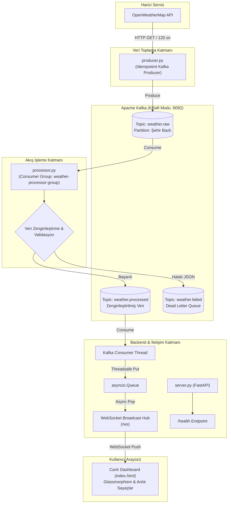

<div align="center">

# 🌍 Real-Time Weather Stream Processing
### Apache Kafka, KRaft, FastAPI & WebSocket ile Dağıtık Olay Akış Mimarisi


-231F20?style=for-the-badge&logo=apachekafka&logoColor=white)


<p align="center">
  <b>Canlı hava durumu verilerini toplayan, gerçek zamanlı zenginleştiren (Heat Index, Rüzgar Sınıflandırması, Aşırı Hava Uyarıları) ve WebSocket üzerinden modern bir Dashboard'a yayınlayan uçtan uca akış işleme (stream processing) platformu.</b>
</p>

[Özellikler](#-öne-çıkan-özellikler) •
[Mimari](#-sistem-mimarisi--veri-akışı) •
[Veri Modeli](#-veri-akış-ve-zenginleştirme-modeli) •
[Kurulum](#-hızlı-başlangıç--kurulum) •
[Dashboard Özellikleri](#-canlı-dashboard-özellikleri) •
[Mühendislik Detayları](#-mühendislik-kararları-ve-tasarım-prensipleri)

---

</div>

## 📌 Proje Genel Bakışı

Bu proje, modern büyük veri ve veri mühendisliği pratiklerini kullanarak **olay odaklı (event-driven)** bir mikroservis hattı kurmayı hedefler:

1. **Veri Toplama (Ingestion):** OpenWeatherMap REST API üzerinden 8 büyük şehir (*İstanbul, Ankara, İzmir, Bursa, Antalya, Bitlis, Trabzon, Giresun*) için periyodik hava durumu verisi çekilir.
2. **Dağıtık Mesajlaşma (Kafka KRaft):** ZooKeeper bağımlılığı olmayan modern Apache Kafka KRaft modunda güvenilir, sıralı ve idempotent mesaj iletimi sağlanır.
3. **Akış İşleme & Zenginleştirme (Stream Processing):** Gelen ham veriler anlık olarak matematiksel ısı indeksi formüllerine (Rothfusz regresyonu) tabi tutulur, rüzgar kategorilerine ayrılır ve aşırı hava durumu uyarı etiketleri eklenir. Hatalı paketler **Dead Letter Queue (DLQ)** topic'ine yönlendirilir.
4. **Gerçek Zamanlı İletim & Görselleştirme:** FastAPI arka plan iş parçacığı (worker thread) ile Kafka'yı tüketir, `asyncio` kuyruğu üzerinden bağlı WebSocket istemcilerine yayar. Glassmorphism tasarımına sahip web arayüzünde veriler sayfa yenilenmeden anlık güncellenir.

---

## ✨ Öne Çıkan Özellikler

- ⚡ **ZooKeeper'sız KRaft Mimarisi:** Confluent Kafka 7.5.0 ile hafif, modern ve hızlı küme yapısı.
- 🔁 **At-Least-Once & Idempotent Üretici:** Veri kaybını ve mükerrer kayıtları önleyen `enable.idempotence: True` yapılandırması.
- 🧠 **Veri Zenginleştirme (Data Enrichment):**
  - **Rothfusz Isı İndeksi (Heat Index):** Sıcaklık ve nem oranına bağlı hissedilen gerçek termal etki hesabı.
  - **Beaufort Ölçeği Benzeri Rüzgar Sınıflandırması:** *Durgun, Hafif Esinti, Orta Rüzgar, Kuvvetli Rüzgar, Fırtına*.
  - **Kritik Eşik Uyarıları:** 🔴 *Aşırı Sıcaklık*, 🟠 *Yüksek Sıcaklık*, 🔵 *Donma Tehlikesi*, 🟡 *Düşük Sıcaklık*, 🟢 *Normal*.
- 🛡️ **Dead Letter Queue (DLQ) Deseni:** Bozuk veya çözümlenemeyen JSON mesajları akışı tıkamadan `weather.failed` topic'ine izole edilir.
- 🔄 **Manuel Offset Yönetimi:** Yalnızca başarıyla işlenen mesajların offset'i Kafka'ya commit edilir (`enable.auto.commit: False`).
- 🌐 **Async Broadcast & Bellek Önbelleği:** Yeni bağlanan istemcilere anında son durum iletilir (State Hydration) ve kopan bağlantılar otomatik temizlenir.
- 📊 **Dahili Gözlemlenebilirlik:** Docker Compose ile gelen **Kafka UI** üzerinden topic'ler, partition'lar, consumer lag ve mesaj içerikleri web üzerinden izlenebilir.

---

## 🏗️ Sistem Mimarisi & Veri Akışı



---

## 📊 Veri Akış ve Zenginleştirme Modeli

### 1. Ham Veri (`weather.raw`)
Producer tarafından OpenWeatherMap API'sinden çekilip normalize edilen ilk veri:

```json
{
  "city": "istanbul",
  "temp_c": 19.4,
  "feels_like": 19.1,
  "humidity": 68,
  "wind_kmh": 14.8,
  "description": "parçalı bulutlu",
  "icon": "03d",
  "timestamp": 1746002400,
  "lat": 41.01,
  "lon": 28.98
}
```

### 2. Zenginleştirilmiş Veri (`weather.processed`)
`processor.py` tarafından işlenmiş, analitik hesaplamaları tamamlanmış ve arayüze hazır veri:

```json
{
  "city": "istanbul",
  "temp_c": 19.4,
  "feels_like": 19.1,
  "humidity": 68,
  "wind_kmh": 14.8,
  "description": "parçalı bulutlu",
  "icon": "03d",
  "timestamp": 1746002400,
  "lat": 41.01,
  "lon": 28.98,
  "alert": "🟢 NORMAL",
  "heat_index": 19.4,
  "wind_category": "Hafif esinti"
}
```

---

## 🗂️ Proje Dizin Yapısı

```text
hava-durumu/
├── docker-compose.yml     # Apache Kafka (KRaft) & Kafka UI servis tanımları
├── producer.py            # OpenWeatherMap'ten veri çeken ve Kafka'ya atan servis
├── processor.py           # Ham veriyi işleyip zenginleştiren Kafka stream processor
├── server.py              # FastAPI WebSocket sunucusu ve statik dosya servisi
├── index.html             # Gerçek zamanlı modern Glassmorphism gösterge paneli
├── requirements.txt       # Python kütüphane bağımlılıkları listesi
├── .env.example           # Örnek çevre değişkenleri şablonu (Güvenli)
├── .gitignore             # Hassas veri ve önbellek koruma kuralları
└── README.md              # Proje dokümantasyonu
```

---

## 🚀 Hızlı Başlangıç & Kurulum

### 1. Ön Gereksinimler
- **Python:** 3.10 veya üzeri
- **Docker & Docker Compose:** Güncel sürüm
- **OpenWeatherMap Hesabı:** [Kayıt olarak](https://home.openweathermap.org/users/sign_up) ücretsiz bir API anahtarı edinin.

---

### 2. Depoyu Klonlama ve Sanal Ortam Kurulumu

```bash
# Depoyu klonlayın
git clone https://github.com/AliFurkanOZ/hava-durumu.git
cd hava-durumu

# Sanal ortamı oluşturun
python -m venv .venv

# Sanal ortamı aktifleştirin
# Windows (PowerShell):
.venv\Scripts\Activate.ps1
# Linux / macOS:
source .venv/bin/activate

# Gerekli bağımlılıkları yükleyin
pip install -r requirements.txt
```

---

### 3. Çevre Değişkenlerini (`.env`) Ayarlama

`.env.example` şablonunu kopyalayarak yerel `.env` dosyanızı oluşturun:

```bash
# Windows (PowerShell):
Copy-Item .env.example .env

# Linux / macOS:
cp .env.example .env
```

Oluşan `.env` dosyasını bir metin editörüyle açın ve kendi API anahtarınızı girin:

```env
OPENWEATHER_API_KEY=buraya_aldiginiz_api_anahtarini_yazin
KAFKA_BROKER=localhost:9092
```

---

### 4. Sistemi Çalıştırma (4 Adım)

Sistem bileşenlerini gözlemleyebilmek için 4 ayrı terminal penceresinde aşağıdaki adımları sırayla başlatın:

#### 🟢 Adım 1: Kafka ve Kafka UI Konteynerlerini Başlatın
```bash
docker compose up -d
```
> 🔍 **Kontrol:** Tarayıcınızdan `http://localhost:8080` adresine giderek **Kafka UI** paneline erişebilir, broker durumunu görebilirsiniz.

#### 🟢 Adım 2: Web Sunucusunu (FastAPI) Başlatın
```bash
python server.py
```
> 🌐 **Dashboard:** `http://localhost:8000` adresinden canlı web paneline ulaşabilirsiniz.

#### 🟢 Adım 3: Akış İşleyiciyi (Stream Processor) Başlatın
```bash
python processor.py
```
> Ham mesajları dinlemeye başlar, hesaplamaları yapar ve `weather.processed` topic'ine aktarır.

#### 🟢 Adım 4: Veri Üreticiyi (Producer) Başlatın
```bash
python producer.py
```
> Belirlenen şehirler için hava verilerini çeker ve Kafka'ya iletmeye başlar.

---

## 🖥️ Canlı Dashboard Özellikleri

`index.html` modern CSS değişkenleri, flexbox/grid ve esnek WebSocket bağlantısı ile donatılmıştır:

- 🟢 **Canlı Bağlantı Rozeti:** WebSocket bağlantı durumu yeşil (Bağlı) / kırmızı (Koptu - Otomatik Yeniden Bağlanma) olarak gerçek zamanlı gösterilir.
- 🌡️ **Dinamik Sıcaklık Gradyanı:** Şehir kartlarındaki sıcaklık değeri; soğuk derecelerde mavi-mor, ılıman derecelerde turkuaz, yüksek sıcaklıklarda ise canlı turuncu-kırmızı gradyan ile görselleştirilir.
- ⚡ **Kart Flaş Animasyonu:** Bir şehre ait yeni paket ulaştığında ilgili kart hafif bir ışıma efektiyle kendini belli eder.
- 📈 **Üst İstatistik Çubuğu:** Takip edilen şehir sayısı, işlenen toplam mesaj adedi ve son güncelleme zamanı canlı akar.
- 🔍 **Geliştirici Konsolu (Raw JSON Stream):** Arka planda akan son zenginleştirilmiş JSON verisini doğrudan panel üzerinden inceleyebilirsiniz.

---

## 🧭 Mühendislik Kararları ve Tasarım Prensipleri

| Karar / Mimari Desen | Neden Tercih Edildi? | Faydası |
|---|---|---|
| **Kafka KRaft Modu** | ZooKeeper'ın bakım ve kaynak yükünü ortadan kaldırmak için. | Daha hızlı kurulum, düşük bellek tüketimi, modern Kafka standardı. |
| **Idempotent Producer** | Ağ dalgalanmalarında tekrar gönderilen mesajların mükerrerliğe yol açmasını engellemek için. | Veri kirliliği ve mükerrer kayıtlar önlenir. |
| **Manuel Commit (`enable.auto.commit: False`)** | Mesaj işlenmeden önce offset commit edilirse veri kaybı yaşanabilir. | Sadece başarıyla işlenen ve sonraki topic'e iletilen mesajlar commit edilir (At-least-once). |
| **Dead Letter Queue (DLQ)** | Bozuk veri geldiğinde processor döngüsünün kilitlenmesini veya çökmesini engellemek için. | Bozuk paketler `weather.failed` topic'ine atılır, sistem kesintisiz çalışmaya devam eder. |
| **Thread-Safe WebSocket Hub** | Kafka senkron I/O (`poll`) ile FastAPI asenkron event loop'unu uyumlu çalıştırmak için. | Arka planda bağımsız thread `poll` yapar, `asyncio.run_coroutine_threadsafe` ile asyncio kuyruğuna güvenle iletir. |

---

## 📡 API Uç Noktaları

| Metot | Uç Nokta | Açıklama |
|---|---|---|
| `GET` | `/` | Canlı hava durumu dashboard arayüzünü (HTML) servis eder. |
| `GET` | `/health` | Sunucu durumu, aktif WebSocket istemci sayısı, kuyruk boyutu ve önbellek bilgisini döner. |
| `WS` | `/ws` | Gerçek zamanlı hava durumu verilerini JSON formatında ileten WebSocket kanalı. |

---

## 🔒 Güvenlik Notları

- Gerçek API anahtarları `.env` dosyasında tutulur ve `.gitignore` ile depoya yüklenmesi engellenmiştir.
- `producer.py` içinde API anahtarının tanımlı olup olmadığını denetleyen güvenlik doğrulaması bulunur.
- GitHub'a sadece genel kullanıma uygun `.env.example` şablonu yüklenir.

---

## 👨‍💻 Geliştirici & Lisans

Geliştirici: **Ali Furkan ÖZ**  
GitHub: [@AliFurkanOZ](https://github.com/AliFurkanOZ)  

Bu proje [MIT Lisansı](LICENSE) kapsamında açık kaynak olarak sunulmuştur.
